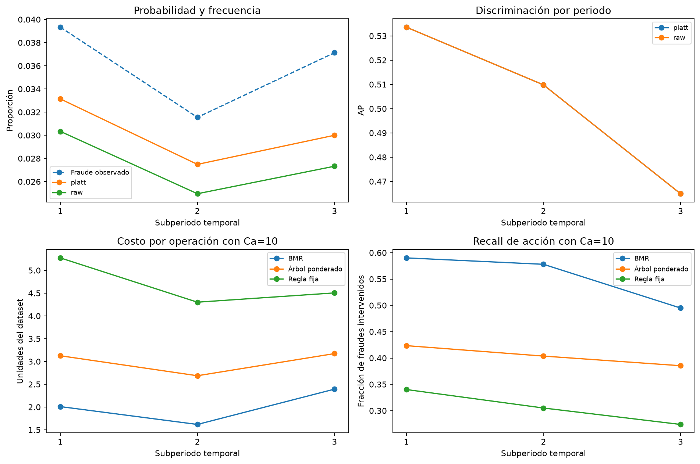
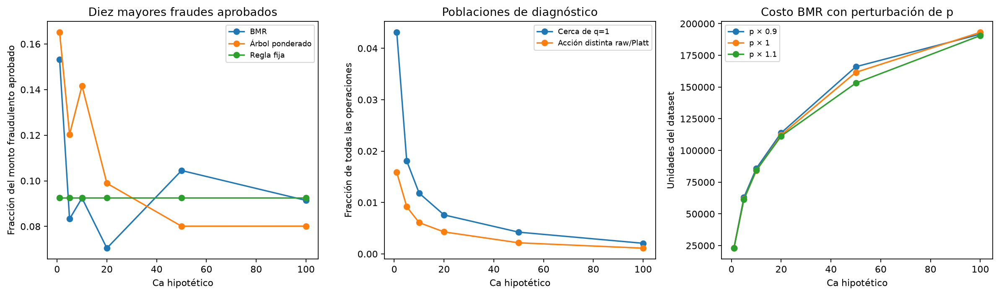

# Etapa 06 — Estabilidad temporal y errores económicos

> Alcance de etapa: este informe conserva la metodología y resultados al cerrar esta fase. La secuencia completa y el test ya evaluado se consolidan en el [informe 08](08_evaluacion_temporal_final.md). Los pasos futuros aquí descritos se leen en ese orden histórico.

## 1. Pregunta y alcance

Después de seleccionar y adoptar LightGBM, necesitamos comprender si las métricas agregadas del 05 representan de manera similar todos los momentos del bloque, qué fraude seguimos aprobando y qué tan sensibles son las acciones a las probabilidades. Este análisis utiliza exclusivamente las 42.047 operaciones de validación posterior, con 1.517 fraudes, sus probabilidades y las acciones verificadas del 05.

No cargamos modelos, no producimos inferencias nuevas y no ajustamos predictor, calibrador ni árboles. El test permanece sin puntuar. La validación ya fue consultada; los resultados son diagnósticos de desarrollo y no una evaluación independiente. Sigue vigente la consulta histórica de etiquetas agregadas del periodo final en EDA/partición.

## 2. Diseño del diagnóstico

El notebook registra el protocolo antes de calcular los diagnósticos: tres subperiodos de igual duración, seis Ca hipotéticos (1, 5, 10, 20, 50 y 100), concentraciones superiores de 1, 5 y 10 fraudes aprobados y las bandas de monto del 05. Cada subperiodo dura teóricamente unos 5,30 días. Los límites dependen solo del rango de TransactionDT; los instantes iguales permanecen juntos y el último límite incluye el máximo.

No creamos nuevos gaps entre estos subperiodos porque ninguno se utiliza para ajustar un modelo: todos son partes del mismo diagnóstico. El registro local no equivale a una preregistración externa ni borra la exploración previa. Ca=10 se usa como ilustración por continuidad con el 05; conservamos todos los escenarios en las tablas.

Para cada periodo calculamos AP, Brier, log-loss, recall, precision y tasa de intervención de legítimas, con probabilidades raw y Platt. Para las tres políticas calculamos costos y componentes. Comprobamos que los componentes sumados reproduzcan los totales del 05. Los porcentajes y las mejores referencias triviales de cada periodo no se suman: tienen denominadores y decisiones de referencia propios.

## 3. Probabilidades y discriminación en el tiempo

| Periodo | Operaciones | Fraudes | Prevalencia | Probabilidad Platt media | AP |
|---|---|---|---|---|---|
| 1 | 14,949 | 588 | 3.93% | 3.31% | 0.53358 |
| 2 | 13,820 | 436 | 3.15% | 2.75% | 0.50981 |
| 3 | 13,278 | 493 | 3.71% | 3.00% | 0.46494 |

La AP disminuye de 0,53358 a 0,46494 entre el primer y tercer periodo. La prevalencia no disminuye de forma monótona: cae en el segundo y vuelve a subir en el tercero. Observamos variación temporal en la capacidad de ordenamiento y en las poblaciones, sin poder atribuir causalidad ni demostrar deriva de concepto con este análisis.

Platt mejora Brier y log-loss respecto a raw en los tres periodos y conserva AP. Sin embargo, la probabilidad media calibrada queda por debajo de la frecuencia observada en los tres. La coincidencia de medias tampoco garantizaría calibración en cada nivel de riesgo; estos resultados se complementan con el análisis por monto.

## 4. Costos y compromiso de intervención

| Periodo | Costo BMR | Costo por operación | Recall | Legítimas intervenidas | Mejora frente a fija |
|---|---|---|---|---|---|
| 1 | 30,038.947 | 2.0094 | 59.01% | 6.12% | 61.90% |
| 2 | 22,358.802 | 1.6179 | 57.80% | 4.90% | 62.39% |
| 3 | 31,771.976 | 2.3928 | 49.49% | 6.32% | 46.89% |

Con Ca=10, el costo por operación de BMR pasa de 2,0094 a 1,6179 y luego a 2,3928. La mejora frente a la regla fija es 61,90%, 62,39% y 46,89%, respectivamente. Por tanto, la ventaja económica agregada no tiene la misma magnitud en todos los periodos. En el tercero disminuye recall de fraude y aumenta la proporción de legítimas intervenidas respecto al segundo.

BMR presenta el menor costo de las tres políticas en **17 de las 18 combinaciones periodo/Ca**. La excepción ocurre en el periodo 3 con Ca=100: el árbol cuesta 60.920,554 frente a 62.314,953 de BMR, una diferencia de 1.394,399 unidades. El resultado agregado del 05 —BMR con menor costo en los seis Ca— sigue siendo correcto, pero no implica que gane en cada subperiodo. No afirmamos dominancia universal ni significación estadística.

El número de transacciones varía entre periodos; por eso acompañamos costo total con costo por operación. Ninguna de estas diferencias representa ahorro bancario observado: conservamos la matriz simplificada y unidades sin moneda verificada.

## 5. Concentración del fraude aprobado

Con Ca=10 obtenemos:

| Política | Fraudes aprobados | Monto fraudulento aprobado | Monto de los 10 mayores | Fracción de pérdida aprobada |
|---|---|---|---|---|
| fixed_0_5 | 1049 | 192,144.916 | 17,773.39 | 9.25% |
| bmr | 674 | 52,309.725 | 4,834.75 | 9.24% |
| cost_sensitive_tree | 902 | 93,092.237 | 13,190.44 | 14.17% |

Los diez mayores fraudes aprobados por BMR concentran 9,24% de su pérdida fraudulenta residual. El mayor tiene monto 738,95, frente a 3.822,95 en la regla fija y 3.260,05 en el árbol. Esto describe cuáles pérdidas quedan bajo cada política; no explica por sí solo las características que causaron sus predicciones.

La pérdida BMR no se reduce a esos diez casos: el resto representa aproximadamente 90,76% de 52.309,725 unidades, repartido entre otros fraudes aprobados. Tampoco confundimos esa pérdida con el costo total, que incluye las intervenciones. Las fracciones de concentración usan como denominador el fraude aprobado de la misma política y Ca; denominadores distintos pueden producir fracciones parecidas con pérdidas absolutas muy diferentes.

## 6. El grupo de montos entre 500 y 1000

El diagnóstico del 05 se mantiene al separar el tiempo:

| Periodo | Operaciones | Fraudes | Frecuencia observada | Probabilidad media Platt | Monto fraudulento | Exposición esperada |
|---|---|---|---|---|---|---|
| 1 | 476 | 57 | 11.97% | 6.56% | 42,406.90 | 23,543.90 |
| 2 | 369 | 36 | 9.76% | 6.56% | 26,682.97 | 17,281.12 |
| 3 | 364 | 23 | 6.32% | 5.03% | 19,710.44 | 13,785.97 |

La probabilidad media Platt queda por debajo de la frecuencia observada en esta banda durante los tres periodos. También queda por debajo la exposición monetaria esperada. El desfase varía y las cantidades de fraudes son 57, 36 y 23: reportamos sus tamaños sin atribuir significación estadística ni extrapolar automáticamente a datos futuros. No generalizamos que todos los montos altos presenten el mismo comportamiento.

## 7. Frontera económica y perturbación de probabilidades

Definimos q=pA/Ca. La banda 0,9≤q≤1,1 recoge operaciones cuyos riesgos estimados de aprobar e intervenir son cercanos. Con Ca=10 contiene 497 operaciones (1,18%): 63 fraudes y 434 legítimas. No hubo empates exactos en la frontera en los seis escenarios observados; el código mantiene aprobación en empate y lo verifica con datos de prueba.

En el mismo Ca, raw y Platt producen acciones distintas en 256 operaciones, todas intervenciones adicionales al utilizar Platt. Esa transformación aprendida no equivale a multiplicar todas las probabilidades por un factor fijo.

| Factor sobre p | Acciones distintas | Costo BMR con Ca=10 | Diferencia frente a base |
|---|---|---|---|
| 0.9 | 226 | 85,895.851 | +1,726.126 |
| 1 | 0 | 84,169.725 | +0.000 |
| 1.1 | 260 | 84,419.336 | +249.611 |

Reducir p un 10% cambia 226 intervenciones a aprobaciones y eleva el costo en 1.726,126 unidades, aproximadamente 2,05%. Aumentarla un 10% agrega 260 intervenciones y eleva el costo en 249,611 unidades, aproximadamente 0,30%. En este escenario ambos cambios empeoran el costo observado; en otros Ca el signo puede diferir. No usamos el menor costo de estas variantes para modificar retrospectivamente el calibrador o elegir Ca.

La banda de q y los casos que cambian al perturbar p no son conjuntos idénticos: los límites de cambio involucran el inverso del factor y el recorte de probabilidades. La perturbación es relativa, se limita a [0,1] y no representa un intervalo de confianza ni otro calibrador. El costo realizado depende de etiquetas y montos concretos; BMR minimiza riesgo esperado con la probabilidad suministrada, sin garantizar el menor costo realizado en toda muestra.

## 8. Qué concluimos y qué sigue

El diagnóstico aporta tres precisiones: la ventaja económica varía por periodo; existe una combinación donde el árbol supera a BMR; y la subestimación en la banda [500,1000) aparece en los tres subperiodos. La selección actual continúa siendo LightGBM con su Platt, pero reconocer estas limitaciones es necesario para defender los resultados.

El siguiente paso es revisar estos hallazgos y fijar un protocolo final con predictor, preparación, calibración, políticas, métricas y escenarios hipotéticos justificados antes de puntuar test. El informe final debe declarar las simplificaciones de costos y la exposición histórica agregada del periodo reservado. Cambiar tipos de variables, activar categorías nativas o probar otro calibrador constituiría un nuevo experimento, no una corrección silenciosa de esta evaluación.

## 9. Evidencia reproducible

El notebook `06_estabilidad_y_errores_economicos.ipynb` tiene celdas cortas de diseño, ejecución, comprobaciones e interpretación. `src/fraud_cost/stability.py` concentra las operaciones reutilizables. La etapa exporta siete tablas agregadas: periodos, probabilidades, costos, calibración por periodo/monto, concentración de pérdidas, frontera y sensibilidad de probabilidad. Dos figuras sintetizan los hallazgos. No duplicamos scores ni acciones por operación.

`estabilidad_protocolo.json` y `estabilidad_config.json` enlazan fuentes, entradas, notebook, tablas y figuras con sus hashes. Verificamos la cadena 03→04→05, la pertenencia de las operaciones a validación, las reglas guardadas fija/BMR y la alineación por ID. La ejecución preservó datos, modelos, manifiesto y evidencias 01–05. La suite completa pasó 23 pruebas; las cinco nuevas cubren límites temporales, alineación, conservación de costos, concentración y sensibilidad. Las pruebas reducen errores de implementación; no certifican validez poblacional ni calibración suficiente.

## Continuación: protocolo técnico congelado

La reproducción local posterior de 05/06 verificó sus doce tablas dentro de tolerancias prefijadas, sin nuevos ajustes. El [notebook/informe 07](07_protocolo_final.md) ya fija LightGBM, su propio Platt, las políticas y escenarios hipotéticos antes de evaluar test. Los registros 05/06 conservan sus flags históricos; la congelación se acredita en el registro posterior. Test sigue sin puntuar.

### Estado posterior de la secuencia

Los 23 tests citados arriba corresponden al cierre histórico del 06, no al total
actual. La revisión consolidada pasó 49 pruebas. El 07 congeló el protocolo y
el 08 ya evaluó test con la versión local explícita, conservando las decisiones.
Las menciones anteriores a “test sin puntuar” describen el momento de esta etapa.
