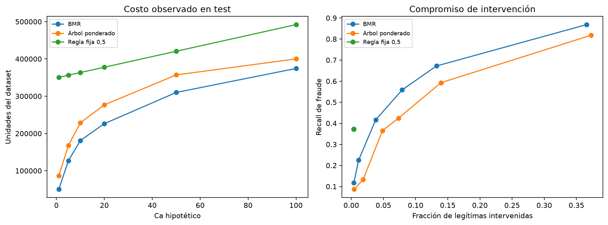
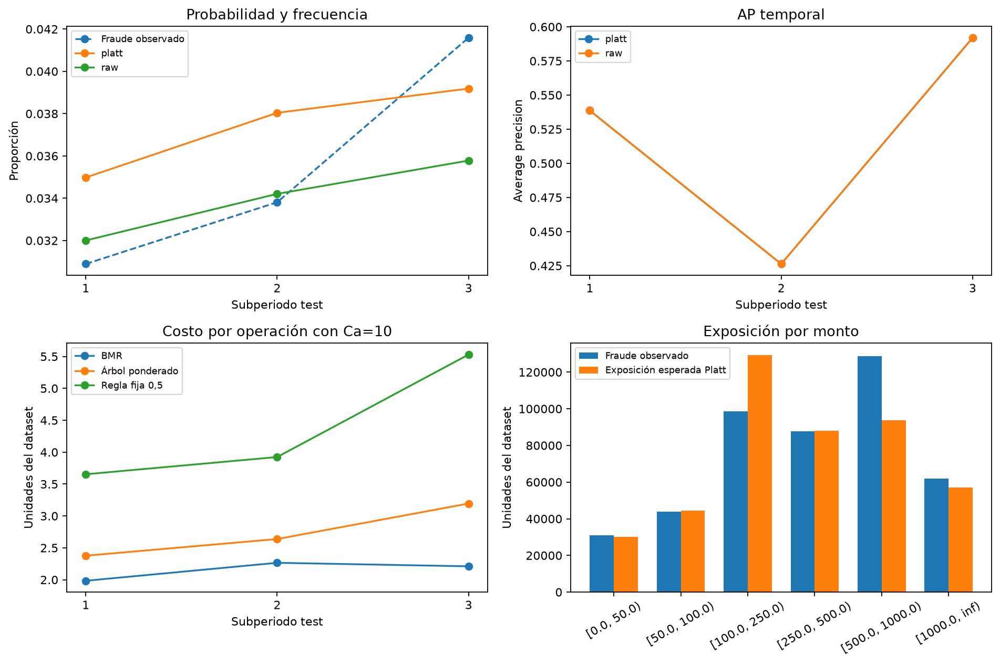

# Etapa 08 — Evaluación temporal final

## 1. Resultado y alcance

Evaluamos las 84.233 transacciones del bloque temporal final con LightGBM, su Platt y las tres políticas congeladas. Encontramos 2.960 fraudes, una prevalencia de 3,51%. BMR obtiene el menor costo de las tres políticas en los seis escenarios completos y las 18 combinaciones de subperiodo/Ca. Con Ca=10 reduce el costo 50,16% frente a la regla fija y 59,91% frente a la mejor referencia trivial.

La mejora económica convive con una limitación: Platt empeora ligeramente Brier y log-loss globales en test, aunque los mejoró en validación. Conservamos el calibrador fijado antes de evaluar; no elegimos retrospectivamente raw por sus métricas. El resultado compara las tres políticas con p calibrada y no identifica causalmente el ahorro atribuible a Platt.

La evaluación es posterior al entrenamiento de los modelos, sin reajuste con validación o test. No es estrictamente ciega desde el inicio: el EDA y la selección histórica de gaps consultaron estadísticas agregadas de este periodo. Los costos suponen intervención eficaz y montos originales como pérdida potencial, sin moneda verificada, capacidad operativa, recuperación o perjuicio comercial adicional. Los ahorros no son pérdidas bancarias netas observadas.

## 2. Qué aportó el compañero y cómo continuamos

El commit `3b679ec` añadió el notebook/informe 07, el protocolo final, comprobaciones y decisiones, dos herramientas de recuperación/reproducción y nuevas pruebas. Reejecutó 05/06 en su equipo, con diferencias numéricas mínimas y sin modificar sus celdas ejecutables. Conservó LightGBM, las 432 entradas, Platt, la matriz y las tres políticas.

También fundamentó los escenarios pequeños con [Bahnsen et al. 2013, sección V.E y tabla VI](https://albahnsen.github.io/files/Cost%20Sensitive%20Credit%20Card%20Fraud%20Detection%20using%20Bayes%20Minimum%20Risk%20-%20Publish.pdf) y [Bahnsen et al. 2014, sección 4](https://albahnsen.github.io/files/%20Improving%20Credit%20Card%20Fraud%20Detection%20by%20using%20Calibrated%20Probabilities%20-%20Publish.pdf). Los trabajos usan otros datos y costos en euros; aquí retenemos escenarios hipotéticos en unidades de TransactionAmt. No trasladamos una estimación operativa de otra empresa al dataset. Los valores 20, 50 y 100 siguen siendo sensibilidad ampliada, no gastos administrativos medidos.

## 3. Reproducción previa entre equipos

El protocolo recibido vinculaba artefactos reconstruidos en Python 3.12; este equipo conserva los originales verificados del 03 en Python 3.11.9. Detectamos diferencias de serialización en cinco archivos locales y fin de línea en tres fuentes. No reemplazamos las huellas del protocolo recibido para presentarlos como idénticos.

Creamos una versión local explícita en un área aislada de `data/interim/final_evaluation_v2/`. Allí reutilizamos los cuatro artefactos originales del 03, ejecutamos 05/06 y congelamos 07. Las doce tablas coincidieron con la evidencia recibida dentro de atol=rtol=10⁻⁸, definidos antes de ejecutar. Las decisiones completas coincidieron; solo admitimos procedencia y diferencias de redondeo de los parámetros de Platt. Equivalencia numérica en validación no significa identidad binaria ni prueba de comportamiento idéntico sobre cualquier población.

`protocolo_ejecucion_local_v2.json` conserva la huella del protocolo recibido, la nueva congelación, diferencias y comprobaciones. La versión local se cerró antes de leer etiquetas/puntuar test. La copia principal de 01–07, sus modelos y resultados quedó intacta. Las copias locales retienen las dependencias para verificar la evaluación; no se suben a Git.

## 4. Ejecución única y datos de entrada

El evaluador crea `evaluacion_test_config.json` mediante apertura exclusiva antes de leer etiquetas. Repite ese vínculo en el área congelada; la existencia de un archivo por sí sola no se usa como bloqueo de concurrencia. Verifica las 84.233 parejas ID/tiempo y su orden con el manifiesto, prepara 432 columnas con el preprocesador aprendido en train y calcula una vez las probabilidades del clasificador. Cada árbol produce acciones para su Ca; no recibe probabilidades de LightGBM.

El monto económico permanece float64. ID, tiempo, etiqueta y split no entran al predictor. El registro conserva inicio, final, protocolo, fuentes y salidas; una interrupción conserva el intento y exige auditarlo. Reejecutar el notebook sobre una corrida completa carga las tablas verificadas sin repetir lectura de datos ni predicciones. No ajustamos modelos, calibradores ni árboles.

## 5. Calidad probabilística

| Probabilidad | AP | Brier | Log loss | Probabilidad media | Recall a 0,5 | Precisión a 0,5 |
|---|---|---|---|---|---|---|
| raw | 0.51780 | 0.02279 | 0.09471 | 3.39% | 34.97% | 79.92% |
| platt | 0.51780 | 0.02300 | 0.09515 | 3.73% | 37.26% | 77.24% |

Platt conserva AP=0,51781 y aumenta recall al corte 0,5, pero baja precisión e incrementa intervenciones de 1.295 a 1.428. Brier pasa de 0,02279 a 0,02300 y log-loss, de 0,09471 a 0,09515. La probabilidad media pasa de 3,39% a 3,73%, frente a prevalencia 3,51%. El diagnóstico global de validación no garantizó la misma mejora probabilística en el periodo final.

La AP externa de validación era 0,50440. El valor test superior no prueba una mejora del modelo: no cambiamos el modelo y las poblaciones son diferentes. Brier/log-loss y el promedio de probabilidades tampoco certifican calibración condicional. No elegimos el calibrador con el resultado test.

## 6. Costos en los seis escenarios

| Ca hipotético | Regla fija | BMR | Árbol ponderado |
|---|---|---|---|
| 1 | 350,614.629 | 50,285.759 | 86,169.783 |
| 5 | 356,326.629 | 126,957.366 | 167,704.701 |
| 10 | 363,466.629 | 181,140.258 | 228,707.974 |
| 20 | 377,746.629 | 226,249.601 | 276,727.440 |
| 50 | 420,586.629 | 309,995.569 | 357,072.308 |
| 100 | 491,986.629 | 374,372.193 | 400,085.919 |

BMR tiene menor costo que las otras dos políticas en los seis escenarios completos. También presenta menor costo en los tres subperiodos por cada Ca, a diferencia de la excepción observada en validación. Esta es una comparación descriptiva del periodo, no superioridad estadística o universal.

La referencia trivial cambia con Ca. Con Ca=1 y Ca=5 conviene intervenir todo frente a aprobar todo en este bloque; con Ca≥10 la mejor referencia es aprobar todo. Con Ca=1 el árbol cuesta 86.169,783, más que intervenir todas las operaciones (84.233), aunque mejora frente a fija. Con Ca=100 fija también supera el costo de aprobar todo. Por eso reportamos los dos denominadores y permitimos ahorros negativos.

## 7. Lectura detallada con Ca igual a 10

| Política | TP | FP | FN | TN | Recall | Legítimas intervenidas | Costo |
|---|---|---|---|---|---|---|---|
| fixed_0_5 | 1103 | 325 | 1857 | 80948 | 37.26% | 0.40% | 363,466.629 |
| bmr | 1653 | 6428 | 1307 | 74845 | 55.84% | 7.91% | 181,140.258 |
| cost_sensitive_tree | 1256 | 5956 | 1704 | 75317 | 42.43% | 7.33% | 228,707.974 |

BMR interviene 8.081 operaciones: 1.653 fraudes y 6.428 legítimas. Aprueba 1.307 fraudes y 74.845 legítimas. El costo 181.140,258 se descompone en 80.810 por intervención y 100.330,258 de fraude aprobado. Su recall por cantidad es 55,84% y captura 77,79% del monto fraudulento. La tasa de intervención de legítimas es 7,91%; la precisión entre intervenciones, 20,46%.

La regla fija cuesta 363.466,629 y el árbol 228.707,974. La mejora BMR frente a fija es 50,16%. El ahorro frente a aprobar todo, que cuesta 451.813,181, es 59,91%. Ambos porcentajes responden a referencias distintas. Una mayor intervención sobre legítimas es parte del compromiso; su costo comercial adicional no está modelado.

## 8. Comparación descriptiva con validación

| Medida con Ca=10 | Validación posterior | Test temporal |
|---|---|---|
| Operaciones | 42.047 | 84.233 |
| Costo BMR por operación | 2.0018 | 2.1505 |
| Recall BMR | 55.57% | 55.84% |
| Legítimas intervenidas BMR | 5.78% | 7.91% |
| Recall por monto | 79.45% | 77.79% |
| Mejora frente a fija | 57.51% | 50.16% |

El recall BMR se mantiene cercano, mientras aumentan la intervención de legítimas y el costo por operación. La mejora frente a fija disminuye de 57,51% a 50,16%. No comparamos costos absolutos como si fueran poblaciones del mismo tamaño: test contiene aproximadamente el doble de operaciones. Esta lectura contextualiza transferencia temporal sin reutilizar test para corregir el predictor.

## 9. Subperiodos y montos

| Periodo | Operaciones | Fraudes | Prevalencia | AP | Media Platt |
|---|---|---|---|---|---|
| 1 | 29,490 | 911 | 3.09% | 0.53865 | 3.50% |
| 2 | 29,281 | 990 | 3.38% | 0.42630 | 3.80% |
| 3 | 25,462 | 1059 | 4.16% | 0.59202 | 3.92% |

La prevalencia aumenta entre los tres subperiodos, mientras AP cae en el segundo y se recupera en el tercero. No hay una degradación monotónica como la observada dentro de validación. Platt empeora Brier/log-loss en los dos primeros subperiodos y los mejora ligeramente en el tercero. No atribuimos estos patrones a una causa específica ni afirmamos deriva demostrada.

| Monto | Operaciones | Fraudes | Frecuencia | Media Platt | Fraude observado | Exposición esperada |
|---|---|---|---|---|---|---|
| [0.0, 50.0) | 27001 | 1159 | 4.29% | 4.31% | 30,958.69 | 30,039.19 |
| [50.0, 100.0) | 22771 | 640 | 2.81% | 2.80% | 43,989.81 | 44,445.78 |
| [100.0, 250.0) | 25412 | 690 | 2.72% | 3.57% | 98,542.89 | 129,298.61 |
| [250.0, 500.0) | 5469 | 258 | 4.72% | 4.80% | 87,859.89 | 88,006.11 |
| [500.0, 1000.0) | 2332 | 172 | 7.38% | 5.84% | 128,656.95 | 93,714.35 |
| [1000.0, inf) | 1248 | 41 | 3.29% | 2.87% | 61,804.96 | 56,971.87 |

La banda [500,1000) conserva subestimación: 7,38% observado frente a 5,84% de media Platt; su exposición esperada es 93.714,35 frente a 128.656,95 observados. En [100,250), en cambio, hay sobreestimación. La exposición global suma 442,475.91 frente a 451,813.18 observados, aproximadamente 2.07% por debajo. La cercanía global puede ocultar desajustes importantes por monto y no contradice que la probabilidad media global esté por encima de la prevalencia.

## 10. Conclusión técnica y trabajo restante

El experimento aporta evidencia de que incorporar probabilidad y monto a la decisión reduce el costo bajo nuestra matriz frente al corte fijo y al árbol ponderado en este periodo. El resultado requiere probabilidades evaluadas, pero no demuestra que Platt sea siempre mejor ni que los costos hipotéticos representen una operación real. Conservamos las limitaciones del ordinal, los doce id tratados numéricamente y CatBoost sin categorías nativas de la comparación previa.

La secuencia técnica 01–08 queda ejecutada. El trabajo restante corresponde a sintetizar metodología, resultados y limitaciones en el informe IEEE de hasta seis páginas y preparar la sustentación con el aval docente requerido por el curso. Otro modelo o calibrador propuesto después de test constituiría otro experimento; este mismo periodo no vuelve a ser una prueba independiente.

## 11. Archivos y comprobaciones

El notebook 08 usa `execution_workspace.py` para la reproducción aislada y `final_evaluation.py` para evaluación y recuperación. Exporta siete tablas: métricas globales, costos globales, periodos, métricas temporales, costos temporales, calibración por monto y calibración por periodo/monto. Añade dos figuras y el registro final. Scores y acciones por operación permanecen en data/interim e ignorados por Git.

Los estados `test_evaluated=False` de etapas previas y protocolos congelados son históricos; el registro 08 tiene `test_evaluated=True`. Revisión técnica no equivale a aval docente. Se preserva la huella del protocolo original y de la versión local evaluada; no se cambian sus decisiones después de ver resultados.

Al cerrar la evaluación 08, la suite pasó **47 pruebas**. Las nuevas verifican equivalencia de decisiones entre versiones, apertura exclusiva previa a test, identidad temporal, reconciliación de costos y recuperación de una corrida completa sin lectura/predicción nueva. Una auditoría adicional recalculó métricas, las 18 comparaciones económicas y los 54 costos temporales desde scores y acciones guardados. También comprobó que la congelación local precedió al inicio de test, que las siete tablas y dos figuras coinciden con sus hashes y que recuperar la corrida real no invoca el lector ni carga modelos. Las pruebas de implementación no sustituyen las limitaciones metodológicas declaradas.

## 12. Auditoría y consolidación posterior

Revisamos el recorrido completo desde las fuentes hasta las tablas finales. La auditoría verifica los ocho notebooks ejecutados, las huellas de sus celdas 03–08, los enlaces locales, las 434 variables originales y 432 entradas, la versión congelada activa, los CSV originales y el manifiesto. Recalcula conteos, tasas, componentes y ambos denominadores de ahorro para las 18 comparaciones y 54 costos temporales. El resultado se guarda en `results/tables/auditoria_proyecto.json` mediante `scripts/audit_project.py --local --output results/tables/auditoria_proyecto.json`.

Corregimos el lenguaje del EDA sobre ausencia y asociación: la cobertura parcial no diagnostica MCAR/MAR/MNAR, una diferencia marginal no garantiza utilidad predictiva y el vocabulario vigente es ordinal aprendido en train. Reejecutamos el EDA y comprobamos equivalencia numérica de sus tablas dentro de 10⁻⁸. Las aclaraciones de etapas previas distinguen su momento histórico del estado final; no alteran las celdas evaluadas 03–08 ni sus modelos, costos o resultados.

Se eliminaron seis artefactos locales sin referencias activas ni congeladas: candidate_isotonic_calibrator.joblib, cost_trees_hypothetical.joblib, selected_xgboost_platt.joblib, decisiones_economicas_validation.parquet, validation_run_metadata.json y validation_scores_selected.parquet. Pertenecían al pipeline retirado. Conservamos datos originales, modelos actuales y la copia aislada necesaria para verificar la evaluación. También fijamos los finales de línea de las fuentes y evidencias congeladas para preservar sus bytes al clonar.

La suite actual pasó **49 pruebas sin advertencias** y la comprobación de dependencias no encontró incompatibilidades. La auditoría es de integridad y coherencia de implementación: no convierte el test históricamente consultado en una prueba ciega, no resuelve las doce discrepancias de tipos ni garantiza calibración perfecta o ahorro en producción. Esas limitaciones permanecen declaradas y no se corrigen retrospectivamente usando test.
