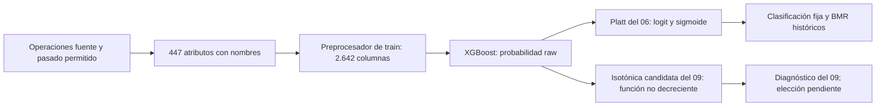

# Diccionario de variables y recorrido hasta las decisiones

Actualización documental: 24 de octubre de 2026. Describimos la preparación y el predictor ejecutados en las etapas 05/06 y utilizados en 07–09. Esta reconstrucción no vuelve predeclaradas las decisiones que se documentan ahora, no corrige retrospectivamente tipos y no produce un experimento nuevo de detección.

### Cómo estudiar este recorrido

Queremos poder explicar una operación desde sus columnas fuente hasta la probabilidad y la acción. Leemos este documento junto con los notebooks; los CSV permiten resolver preguntas sobre una columna concreta sin repetir el experimento.

| Pregunta del equipo | Dónde está la evidencia |
|---|---|
| ¿Qué significa cada original y de qué tabla viene? | Sección 3 y `eda_diccionario_variables.csv` |
| ¿Qué conservamos, excluimos y transformamos? | Secciones 2, 4 y 5; `modelo_diccionario_variables.csv` |
| ¿Qué ingeniería hicimos y con qué pasado? | Sección 6; `features.py` |
| ¿Qué recibe cada objeto y qué entrega? | Sección 7 y notebook 06 |
| ¿Cómo se prepara una operación real? | Sección 11, con posiciones de la matriz |
| ¿Qué hicimos en Platt e isotónica? | [Informe 06](06_reajuste_y_calibracion.md), [informe 09](09_comparacion_calibradores_y_costos.md) y sus notebooks |
| ¿Cómo consultar una variable y responder en la asesoría? | Secciones 12 y 13 |

Distinguimos **Observado** (columnas, código y resultados registrados), **Inferido** (interpretación sustentada, como la necesidad de evaluar categorías futuras), **Supuesto** (por ejemplo, intervención con prevención completa) y **Dato requerido** (moneda, costo real y momento de disponibilidad no verificados). Los nombres anonimizados no completan esos datos requeridos.

## 1. Qué archivos permiten seguir cada variable

El notebook 01 exporta [eda_diccionario_variables.csv](../results/tables/eda_diccionario_variables.csv), con una fila por cada una de las **434 columnas originales**: procedencia, significado verificable, tipo semántico, tipo leído, rol, cardinalidad, ausencia y relación con ingeniería. La ausencia y cardinalidad corresponden al EDA global histórico; no son estadísticas permitidas para ajustar el predictor.

La auditoría del artefacto del 06 exporta [modelo_diccionario_variables.csv](../results/tables/modelo_diccionario_variables.csv): **451 filas**, incluyendo `has_identity`, `split` y los quince atributos nuevos. Allí se identifica qué entra, su rama real de preparación, tratamiento, mediana de train cuando corresponde, indicador de ausencia y número de columnas que aporta a la matriz. No hay 451 predictores: cuatro filas son auxiliares o etiqueta y quedan fuera de X.

[modelo_matriz_variables.csv](../results/tables/modelo_matriz_variables.csv) enumera las **2.642 posiciones**, desde cero, con variable de origen, nombre de columna y operación: valor numérico imputado, indicador de ausencia o categoría one-hot. La configuración [inventario_variables_config.json](../results/tables/inventario_variables_config.json) conserva los hashes de esta auditoría, modelo y salidas. No reemplaza los registros originales del entrenamiento.

Las tablas completas son el detalle por variable. Los cuadros de este documento agrupan nombres para facilitar su lectura; no omiten columnas ni implican que el modelo usa solo esos ejemplos.

## 2. De las tablas originales a los atributos

| Paso | Cantidad | Qué significa |
|---|---:|---|
| train_transaction | 394 | Incluye TransactionID, TransactionDT e isFraud |
| train_identity | 41 | Incluye la misma clave TransactionID; aporta 40 columnas no clave |
| Unión izquierda uno a uno | 434 | 394+41−1; conserva las 590.540 transacciones |
| Originales como predictores | 431 | Excluimos entrada directa de ID, tiempo crudo y etiqueta |
| Representación base | 432 | Añadimos has_identity |
| Representación ampliada | 447 | Añadimos quince atributos, conservando los originales permitidos |
| Tipos antes de codificar | 37 categóricos y 410 numéricos | Clasificación efectiva del preprocesador del 06 |
| Matriz transformada | 2.642 | 410 valores numéricos + 342 indicadores de ausencia + 1.890 columnas one-hot |

`split` se añade para controlar bloques, pero no entra como predictor ni aumenta los 447. Tampoco duplicamos TransactionID al unir. No usamos una selección automática de variables por importancia, correlación, PCA, ausencia o cardinalidad. La selección del 05 compara representaciones y configuraciones, no descubre una lista de columnas originales eliminadas.

Conservamos las 431 originales permitidas. Que un árbol no use una columna en ninguna división no significa que la hayamos eliminado del pipeline. Conservar una variable tampoco demuestra que contribuya favorablemente.

## 3. Qué sabemos de las variables originales

| Familia | Nombres | Información verificable y límite |
|---|---|---|
| Identificación | TransactionID | Clave de operación, no identidad de una persona |
| Objetivo | isFraud | Etiqueta observada binaria, nunca atributo de inferencia |
| Tiempo | TransactionDT | Segundos relativos; orden y fases, no calendario local verificado |
| Monto | TransactionAmt | Magnitud original, sin moneda verificada en este proyecto |
| Producto | ProductCD | Código de producto; no asignamos significados a cada letra |
| Tarjeta | card1–card6 | Códigos relacionados con tarjeta; no reconstruimos número ni titular |
| Dirección | addr1–addr2 | Códigos de dirección, no dirección personal reconstruida |
| Distancia | dist1–dist2 | Descriptores numéricos; escala física específica no verificada aquí |
| Correo | P_emaildomain, R_emaildomain | Dominios de comprador/destinatario, no cuentas completas |
| C | C1–C14 | Descriptores anonimizados; no inventamos una definición individual |
| D | D1–D15 | Descriptores anonimizados; no equiparamos cada columna a un retraso concreto |
| M | M1–M9 | Códigos categóricos anonimizados |
| V | V1–V339 | Atributos anonimizados del proveedor, no ingeniería creada por nosotros |
| Identidad | id_01–id_38 | Descriptores de identidad con significado individual no verificado |
| Dispositivo | DeviceType, DeviceInfo | Tipo/descriptor de dispositivo; no identidad física garantizada |

El diccionario explicita el anonimizado en lugar de llenar vacíos con interpretaciones plausibles. Los nombres de familias son útiles para organizar, pero no prueban causalidad ni revelan cómo fueron construidas todas las variables del proveedor.

## 4. Tipo semántico, almacenamiento y tratamiento real

Una variable categórica expresa pertenencia a una categoría. Un entero puede ser su código; no necesariamente una magnitud ordenada. El dtype de pandas refleja almacenamiento, no ese significado. Después del one-hot todas las entradas de XGBoost son números, sin que por ello la variable original se vuelva continua.

### 4.1. Las 37 variables efectivamente categóricas

Conservamos ProductCD; card1–card6; addr1–addr2; P_emaildomain y R_emaildomain; M1–M9; DeviceType y DeviceInfo. Añadimos a esa rama las columnas de identidad que llegan como texto: id_12, id_15, id_16, id_23, id_27, id_28, id_29, id_30, id_31, id_33, id_34, id_35, id_36, id_37 e id_38.

El código combina una lista explícita con detección de object/string/category. Convertimos esas columnas a texto y representamos ausencia con `__MISSING__`. OneHotEncoder aprende su vocabulario y agrupa niveles con menos de 50 apariciones en el entrenamiento correspondiente. Esa frecuencia se refiere al entrenamiento de cada fold y luego a todo train, no al dataset completo.

Una categoría desconocida en evaluación no genera una columna nueva: `handle_unknown='ignore'` produce ceros en el bloque de esa variable. No se asimila automáticamente al grupo de categorías raras conocidas. El token de ausencia también participa en el vocabulario y puede agruparse por la misma regla. No usamos target encoding ni códigos ordinales aprendidos de tasas de fraude.

Ausente, rara y desconocida son situaciones distintas. Ausente significa que no recibimos un valor y lo representamos con el token; rara es una categoría observada pocas veces en train; desconocida es una categoría que no estuvo en el vocabulario ajustado. La frecuencia mínima 50 agrupa las raras conocidas. El comportamiento de una desconocida lo establece `handle_unknown`, sin consultar su etiqueta ni añadir columnas futuras.

### 4.2. Las variables tratadas numéricamente

Las 410 entradas numéricas ampliadas incluyen TransactionAmt, dist1–dist2, C1–C14, D1–D15, V1–V339, id_01–id_11, los doce id enumerados debajo, has_identity y los quince atributos nuevos. Antes de estos quince tenemos 395 numéricas y 37 categóricas en la representación base.

Convertimos infinitos en NaN y aprendemos la mediana por columna únicamente del entrenamiento. `add_indicator=True` crea indicadores para columnas que presentan ausencia al ajustar; no garantiza un indicador adicional para toda columna que se vuelva ausente por primera vez en el futuro. `keep_empty_features=True` permite conservar una columna completamente vacía; el tratamiento de ese caso no debe describirse como una mediana observada inexistente. En los entrenamientos documentados no encontramos columnas de entrada completamente vacías.

La matriz se convierte a float32 y se conserva dispersa cuando corresponde. No estandarizamos, normalizamos a [0,1] ni truncamos montos extremos automáticamente. El monto para evaluación económica se mantiene en su precisión original, separado de la representación predictiva.

TransactionAmt tiene una validación adicional antes de construir atributos: el monto debe existir, ser finito y no negativo. Una operación que incumpla esa condición se rechaza en la interfaz fuente; la mediana de monto registrada en el preprocesador no significa que aceptemos rescatar allí una operación sin monto.

Un valor numérico imputado y su indicador responden a preguntas diferentes: el primero permite procesar la magnitud; el segundo conserva que el valor original faltaba. La mediana no reconstruye el dato verdadero. Tampoco un indicador demuestra el mecanismo MCAR, MAR o MNAR. Por ejemplo, V258 aporta su valor preparado y un indicador adicional porque presentó ausencias durante el ajuste.

### 4.3. Ejemplos para distinguir significado y representación

| Variable | Almacenamiento del EDA | Tipo semántico | Tratamiento efectivo en el 06 | Columnas transformadas |
|---|---|---|---|---:|
| TransactionAmt | float64 | Numérica | Valor predictivo float32; monto económico conservado aparte | 1 |
| ProductCD | object | Categórica | Token de ausencia y one-hot | 5 |
| card1 | int64 | Categórica | Se convierte a texto y se codifica one-hot | 884 |
| V258 | float64 | Numérica anonimizada | Mediana de train e indicador de ausencia | 2 |
| id_13 | float64 | Categórica según proveedor | Numérica con mediana e indicador: discrepancia pendiente | 2 |

Estos conteos se leen del inventario del reajuste concreto; no se deducen de la cardinalidad global del EDA. Una variable puede expandirse a muchas columnas y otra aportar solo una. Los 342 indicadores corresponden a columnas numéricas que faltaron al ajustar; no se suman 447 indicadores por defecto.

### 4.4. Discrepancia pendiente en doce códigos de identidad

La [descripción de Kaggle](https://www.kaggle.com/competitions/ieee-fraud-detection/data) incluye id_12–id_38 entre las categóricas. Nuestro pipeline dejó numéricas id_13, id_14, id_17, id_18, id_19, id_20, id_21, id_22, id_24, id_25, id_26 e id_32, porque llegaron como números y no estaban en la lista explícita.

Esto no es una selección deliberada respaldada por un experimento: es una discrepancia entre semántica declarada y preparación actual. Los árboles pueden dividir esos códigos como números e introducir un orden no justificado. Las doce columnas se señalan individualmente en los inventarios. No las eliminamos ni recodificamos al escribir esta documentación: cambiar ese tratamiento exige registrar otra preparación y repetir las etapas experimentales necesarias. No cambiaremos un resultado publicado sustituyendo únicamente el archivo del modelo.

## 5. Columnas auxiliares y usos múltiples

TransactionID une tablas, vincula el manifiesto y alinea probabilidades y acciones. Se excluye de X para no tratar una clave como señal predictiva. isFraud es y: ajusta el predictor y calibradores en sus bloques permitidos y sirve para evaluar después; no participa en X ni en las estadísticas históricas.

TransactionDT se excluye como número crudo de X, pero determina bloques, pasado disponible y ciclos relativos. No decimos que se descartó del proyecto. split administra permisos; train, gaps, validación y test no son categorías predictivas. La lista usecols del notebook 02 es una carga mínima para partir, no una eliminación definitiva de las demás variables.

TransactionAmt conserva dos funciones distintas: atributo predictivo y costo proxy de aprobar fraude. Su versión logarítmica amplía X, pero nunca reemplaza A en la matriz. Ca es un parámetro exógeno por escenario, no una columna original ni entrada del XGBoost actual.

## 6. La ingeniería que sí construimos

| Atributo nuevo | Padres y cálculo | Tratamiento y finalidad |
|---|---|---|
| has_identity | TransactionID de ambas tablas; 1 si hay correspondencia | Binaria numérica; ausencia estructural, no prueba de identidad real |
| amount_log1p | log(1+TransactionAmt) | Numérica; comprime escala y conserva cero |
| missing_count | Conteo de NaN en las entradas base y amount_log1p antes de rellenar categorías | Numérica; disponibilidad por fila, sin etiqueta |
| relative_day_sin / cos | sin/cos(2π·TransactionDT/86400) | Dos numéricas; fase diaria relativa |
| relative_week_sin / cos | sin/cos(2π·TransactionDT/604800) | Dos numéricas; fase semanal relativa |
| card_proxy_past_count | Conteo anterior por card1+card2+card3+card5 | Numérica; frecuencia del proxy |
| card_proxy_past_mean_amount | Media anterior de montos de ese proxy | Numérica; monto previo, no media global futura |
| card_proxy_seconds_since_last | Tiempo actual menos último tiempo anterior del proxy | Numérica; recencia |
| device_proxy_past_count / past_mean_amount / seconds_since_last | Los mismos tres cálculos, agrupados por DeviceInfo | Tres numéricas; no identifican equipos físicos de forma única |
| email_domain_past_count / past_mean_amount / seconds_since_last | Los mismos cálculos por P_emaildomain | Tres numéricas; un dominio puede agrupar muchos usuarios |

Has_identity pertenece a las 432 entradas base. Los otros quince son seis atributos de transacción/ciclos y nueve históricos. Split no es ingeniería predictiva. Cada nombre individual y su fórmula figuran en `modelo_diccionario_variables.csv`, sin depender de las abreviaciones de esta tabla.

En train, el historial usa tiempo estrictamente menor: todas las operaciones de un mismo instante comparten pasado. Una agrupación nueva o incompleta recibe conteo cero y media/recencia ausentes; la imputación posterior aprende con train. No interpretamos ese cero exclusivamente como un dispositivo nuevo.

En validación el estado final de train permanece congelado: ni operaciones de gaps ni operaciones previas de validación actualizan conteos, sumas o último instante. La recencia sí aumenta con el tiempo actual. Es una convención de evaluación por lotes, no una simulación de actualización en línea. No construimos tasas de fraude por entidad ni usamos y para estos atributos.

## 7. Qué aprende cada etapa y qué sale del modelo

En el 05 cada fold ajusta historial, medianas y vocabulario con su propio pasado; la configuración se elige por AP media interna. En el 06 reajustamos representación, preprocesador y XGBoost con todo train. Esa matriz tiene 380.815 filas y 2.642 columnas. Las dimensiones categóricas varían por fold; 2.642 describe el reajuste concreto, no una anchura universal del algoritmo.

Para inferencia necesitamos las columnas fuente y el tiempo disponible, el mismo historial congelado y preprocesador, no isFraud ni Ca. El objeto conserva la lista y orden de los 447 atributos; no basta concatenar valores numéricos en un orden arbitrario. IDs se mantienen fuera de X para devolver cada resultado a su operación. Las ausencias se representan, no se rellenan manualmente con cero antes de llamar al pipeline.

| Salida o paso | Entrada | Resultado e interpretación |
|---|---|---|
| Constructor de atributos | Operación original y pasado permitido | 447 atributos con nombres; sin y |
| Preprocesador ajustado | Atributos en esquema de entrenamiento | Matriz numérica float32 de 2.642 columnas |
| XGBoost predict_proba | Matriz | Dos columnas para clases [0,1]; usamos la de fraude como p_raw |
| Platt del 06 | Logit de p_raw recortada a [10⁻⁶,1−10⁻⁶] | p_calibrada; no reentrena XGBoost |
| Clasificación fija | p_calibrada | Etiqueta/acción convencional con >=0,5 |
| BMR | p_calibrada, monto original y Ca | Acción intervenir si pA>Ca, aprobar en empate |
| Árbol por Ca | Matriz de atributos; Ca ya incorporado a su entrenamiento | Acción 0 aprobar / 1 intervenir; no nueva probabilidad calibrada de fraude |
| Evaluación | Acciones, y, monto original y Ca | Costos realizados y métricas; y entra después de decidir |

El archivo `validation_scores_selected.parquet` conserva TransactionID, TransactionDT, TransactionAmt, isFraud, probability_raw, probability_calibrated y action_fixed_0_5. La etiqueta está allí para medir, no porque sea una salida predicha o una entrada de inferencia. No confundir el archivo con el vector X.

El 09 añade una isotónica candidata que recibe p_raw directamente y usa predict, no el logit/predict_proba de Platt. No sustituye silenciosamente el contrato del 06. La calidad de una probabilidad debe evaluarse: pertenecer a [0,1] no demuestra calibración adecuada.

### 7.1. Entrada al sistema y entrada al estimador

Cuando decimos «el modelo recibe 2.642 columnas» nos referimos al XGBoost interno. `FittedPredictor.predict_raw(frame)` recibe primero un DataFrame con las columnas fuente para construir los atributos. TransactionID y TransactionDT se requieren en ese recorrido para validar, alinear y calcular pasado, aunque no se entreguen como columnas directas al clasificador. `isFraud` puede estar ausente al inferir.

Para n operaciones, el constructor produce n × 447 atributos y el preprocesador n × 2.642 valores. El `predict_proba` interno produce n × 2, con columnas de clases [0,1]; el objeto devuelve el vector de n probabilidades de fraude. Platt o la isotónica candidata transforman ese vector y conservan la correspondencia de filas. Ningún paso crea una confirmación de fraude.



La función exige operaciones posteriores al final de train, índices/IDs únicos y el mismo esquema de características. El preprocesador selecciona columnas por nombre y mantiene el orden aprendido. La representación dispersa también forma parte del contrato: XGBoost distingue una posición no almacenada de un cero explícito. Densificar o reconstruir manualmente la matriz puede alterar el tratamiento de ausencias; una tabla de one-hot no autoriza a deducir cualquier recorrido de un árbol sin conservar esa representación.

### 7.2. La línea base no es el reajuste seleccionado

| Elemento | Línea base 03/04 | Predictor seleccionado 05/06 y diagnósticos 07–09 |
|---|---|---|
| Atributos previos al preprocesador | 432 base | 447, con quince adicionales |
| Ajuste | Configuración de referencia con profundidad 6 | history_deeper con profundidad 8 y reg_lambda=5 |
| Preparación | Preprocesador propio del notebook 03 | `make_preprocessor` de features.py; matriz registrada de 2.642 columnas |
| Calibración Platt | Ajustada con scores de la línea base | Nuevo ajuste con scores del predictor seleccionado |
| Scores locales esperados | `data/interim/validation_scores.parquet` | `data/interim/validation_scores_selected.parquet` |
| Artefacto esperado | `results/models/baseline_xgboost_platt.joblib` | `results/models/selected_xgboost_platt.joblib` |

Las métricas de un archivo pertenecen al predictor que lo generó. No mezclamos un score baseline con medianas, historial, dimensiones o coeficientes de calibración del selected. La isotónica del 09 también está vinculada a este último predictor.

## 8. Cómo se incorporan los costos sin confundir etiquetas

XGBoost aprende fraude con objetivo logístico, no minimizando directamente nuestra matriz. La política fija y BMR usan sus probabilidades; el árbol ajusta otra tarea de acción con z=1[yA>Ca] y peso |yA−Ca| solo en train. Esos objetivos de acción no reemplazan isFraud en el dataset original.

El costo realizado es Ca por intervención más el monto de fraude aprobado. No sumamos todo el monto de operaciones intervenidas como pérdida y no consideramos gratuitas las revisiones acertadas. Los números de TP/FP de la clasificación a 0,5 no son automáticamente los conteos de fraude/legítimas intervenidos por BMR.

## 9. Reproducción y procedencia de esta ampliación

El notebook 01 mantiene su EDA y exporta el nuevo diccionario durante el perfil de columnas. El 02 explica que su carga mínima no selecciona predictores. Los informes 03, 05 y 06 conectan esos nombres con preparación, aprendizaje y salidas; el notebook 06 amplía la explicación sin cambiar sus celdas ejecutables.

Para auditar el artefacto propio ya ajustado, desde la raíz y el entorno del proyecto:

```python
from pathlib import Path
from fraud_cost.schema import export_model_inventory

catalogo, matriz, registro = export_model_inventory(Path.cwd())
```

Esta función comprueba las fuentes registradas en 05/06 antes de cargar nuestro Joblib, enumera el preprocesador existente y exporta los dos catálogos del modelo y su configuración. No llama fit, no actualiza historial, no predice test y no requiere generar otro notebook. Para un clon sin artefactos locales se ejecutan antes las etapas de entrenamiento correspondientes; no se descarga un Joblib de procedencia desconocida.

Conservamos intactos los notebooks 04/05; el hash del 05 incluye Markdown. La integración posterior de los commits de la profesora usa su versión de 01/02 como base e incorpora el inventario después. El 03 recibe su arranque portable por src y aclaraciones de comentarios, sin cambiar la lógica ni parámetros de su versión entrante y sin volver a ejecutar el modelo base. El registro local histórico de la línea base sigue describiendo las fuentes de aquella corrida, no se reescribe para atribuirla al notebook modificado. En 06 la procedencia ejecutable usa código y sus fuentes se conservan.

La integración regenera EDA y resúmenes de partición, verifica que el manifiesto permanezca idéntico y actualiza únicamente la auditoría del inventario si cambia su CSV descriptivo. No se presentan nuevas probabilidades, métricas o calibradores del 03 como si hubieran sido ejecutados. Cambiar las fuentes y luego reescribir hashes de una corrida anterior para aparentar identidad sería incorrecto.

La revisión del 24 de octubre es documental y de esquema. No aprueba calibrador, Ca ni protocolo final. La discrepancia de tipos, la reutilización de desarrollo y la consulta inicial agregada de etiquetas del periodo final permanecen explícitas. Los resultados históricos no se convierten en resultados de una preparación corregida por explicar mejor sus límites.

## 10. Comprobaciones de esta ampliación

Reejecutamos el notebook 01 completo con el kernel del proyecto, incluida la exportación de las 434 variables. Se verificaron doce grupos de comprobaciones sobre la ampliación: cobertura original; categorías semánticas y discrepancias; creadas y entradas; correspondencia entre regla y rama ajustada; posiciones y conteos de matriz; transformación de filas sintéticas sin predecir; padres y roles auxiliares; rechazo de perfiles incompletos; validez de los nueve notebooks; hashes de 05/06 y artefactos 07–09; conservación del código y fuentes históricas; y registro del modelo sin cambios.

La comprobación sintética confirmó mediana, indicadores y bloques categóricos en la posición documentada, sin ajustar el preprocesador ni llamar al clasificador. Las doce discrepancias de tipo no se confunden con el conteo de columnas de alta ausencia: son problemas distintos y no autorizan eliminaciones automáticas.

La carpeta tests fue retirada previamente en la organización del repositorio. Estas comprobaciones puntuales de la ampliación no se presentan como una nueva ejecución de las 57 pruebas históricas ni como su reemplazo completo. La función de inventario conserva controles reproducibles de cobertura, rama, anchura y procedencia; antes de una modificación algorítmica será necesario recuperar una suite versionada y registrar un nuevo experimento.

## 11. Recorrido de una operación real hasta la matriz

Para estudiar la preparación seguimos TransactionID **3433215**, una operación de validación posterior identificada directamente en `data/raw/train_transaction.csv`. Buscamos su ID en `train_identity.csv` y no encontramos una fila asociada. Los datos originales permanecen locales, excluidos de Git.

| Campo fuente | Valor observado | Papel |
|---|---|---|
| TransactionID | 3433215 | Vincular la explicación con la operación, fuera de X |
| TransactionDT | 11370286 | Tiempo relativo y construcción de historia, fuera de X crudo |
| TransactionAmt | 994 | Predictor y monto original para evaluación económica |
| ProductCD | W | Categoría, sin significado comercial asignado aquí |
| card1 / card2 / card3 / card5 | 14643 / 529 / 150 / 162 | Componentes del proxy histórico |
| C1 / D1 | 1 / 19 | Valores anonimizados observados, sin interpretar su causa |
| V258 | Ausente | Requiere preparación numérica |
| isFraud | 1 | Etiqueta histórica para evaluación; no participa en las entradas |

Recontamos únicamente operaciones con ese proxy dentro de train, cuyo último tiempo es 9521218. Hay **143** operaciones, con monto medio **189,837902…** y último tiempo del proxy **9462570**. Como el historial está congelado, la recencia para el caso es 11370286 − 9462570 = **1907716 segundos**. No incluimos operaciones de gaps ni validación en ese recuento.

El conteo de ausencias antes de rellenar categorías es **208**. No tener fila de identidad produce `has_identity=0`. `log1p(994)` es aproximadamente **6,902743**; el valor preparado usa float32. Estos cálculos describen las entradas y no utilizan isFraud.

| Parte de la representación | Valor preparado | Posición de matriz, desde cero |
|---|---:|---:|
| TransactionAmt | 994 | 0 |
| V258 imputada con mediana de train | 1 | 289 |
| has_identity | 0 | 394 |
| amount_log1p | ≈ 6,902743 | 395 |
| missing_count | 208 | 396 |
| card_proxy_past_count | 143 | 401 |
| Indicador de ausencia de V258 | 1 | 641 |
| Indicadora ProductCD_W | 1 | 756 |

La mediana de V258 y las posiciones proceden de los CSV del inventario del 06; no calculamos una mediana global nueva. Esta tabla muestra una parte de las 2.642 posiciones y no constituye una entrada completa que podamos entregar al estimador.

**Límite de este ejemplo:** en esta copia no están el artefacto selected ni sus scores por operación. Por ello no atribuimos una probabilidad individual del 06 a este caso ni ejecutamos un nuevo clasificador. El recorrido continúa mediante el contrato descrito en la sección 7 y las métricas agregadas reales del 06/09. El ejemplo Platt con p_raw=0,20 de esos informes es didáctico; ese número no es la predicción de esta transacción. Tampoco sustituimos el score por el de la línea base del 03.

## 12. Cómo consultar el detalle por variable

Podemos estudiar los CSV versionados sin cargar modelos ni ejecutar los notebooks. Desde la raíz del repositorio, esta consulta solo lee tablas:

```python
import pandas as pd

originales = pd.read_csv("results/tables/eda_diccionario_variables.csv")
modelo = pd.read_csv("results/tables/modelo_diccionario_variables.csv")
matriz = pd.read_csv("results/tables/modelo_matriz_variables.csv")

nombres = ["TransactionAmt", "ProductCD", "card1", "V258", "id_13"]
detalle = modelo.loc[modelo["variable"].isin(nombres), [
    "variable", "origen", "tipo_semantico", "dtype_union_eda",
    "entra_modelo", "tipo_pipeline_verificado", "tratamiento",
    "mediana_ajustada_train", "indicador_numerico_ausencia",
    "columnas_matriz", "discrepancia_tipo",
]]
print(detalle.to_string(index=False))
print(matriz.loc[matriz["variable"].eq("V258")].to_string(index=False))
```

`origen`, `significado`, `tipo_semantico` y `dtype_union_eda` describen la fuente. `entra_modelo` y `tipo_pipeline_verificado` describen participación y rama efectiva. `variables_padre` y `formula_o_procedencia` identifican los atributos creados. `tratamiento`, `mediana_ajustada_train` e `indicador_numerico_ausencia` describen lo registrado del ajuste. `columnas_matriz` enlaza con posiciones reales; `discrepancia_tipo` señala una revisión pendiente, sin corregirla.

Para las filas auxiliares, una mediana vacía significa que ese campo no pertenece a la rama numérica ajustada. No se interpreta como una mediana cero. La ausencia y cardinalidad EDA son globales e históricas; las medianas registradas pertenecen a train.

## 13. Preguntas que debemos poder responder

| Pregunta de defensa | Respuesta sustentada |
|---|---|
| ¿Qué queremos predecir y cuándo? | Probabilidad de fraude de una operación posterior al entrenamiento, con atributos y pasado permitidos. La disponibilidad operativa exacta de todos los campos anonimizados sigue requiriendo verificación. |
| ¿Por qué card1 es categórica si contiene números? | Son códigos; la distancia entre códigos no demuestra una magnitud. La preparación actual la fuerza a texto y one-hot. |
| ¿Eliminamos las columnas con más ausencia? | No. Conservamos las originales permitidas; cualquier eliminación requeriría una comparación aprendida dentro de train. |
| ¿Las V son ingeniería nuestra? | No. Ya vienen del proveedor. Has_identity y los quince derivados sí los construimos nosotros. |
| ¿Por qué 451 filas en el catálogo y 447 entradas? | El catálogo también incluye ID, tiempo crudo, etiqueta y split, que no son entradas directas. |
| ¿Cuándo se usa la etiqueta real? | Para entrenar y calibrar en sus bloques autorizados y para evaluar después de obtener probabilidades/acciones. No entra en X ni en los agregados históricos. |
| ¿Calibrar equivale a volver a entrenar XGBoost? | No. Se aprende una transformación de sus scores manteniendo fijo predictor, preparación e historial. El 09 solo ajusta isotónica; reutiliza Platt del 06. |
| ¿Ya corregimos los doce códigos de identidad? | No. La documentación los identifica; recodificarlos exige otro experimento y revisar los artefactos posteriores. |
| ¿Ya elegimos calibrador y Ca finales? | No. Los registros mantienen esas decisiones pendientes y test sin puntuar. |

## 14. Alcance de esta explicación y requisitos locales

Esta ampliación conserva fuentes predictivas, datos, tablas, configuraciones y salidas históricas. Completa el relato en los notebooks 01/02/03/06/09 e informes; no presenta una reejecución de entrenamiento o calibración. El notebook 05 permanece intacto porque su huella incluye Markdown.

En esta copia están el modelo y scores de la línea base, pero no los artefactos selected, árboles, acciones ni isotónica en sus rutas esperadas. Los inventarios y resultados agregados versionados permiten estudiar el proceso; reproducir inferencia individual requiere recuperar los artefactos propios con procedencia verificable o regenerar las etapas necesarias en un entorno compatible.

La revisión de fuentes también encontró diferencias de bytes CRLF/LF en módulos que coinciden al normalizar saltos de línea. Las verificaciones estrictas de procedencia pueden detenerse por esa conversión de checkout. Debe revisarse la causa y conservarse la identidad de la corrida: no reescribimos sus hashes para hacer pasar fuentes o resultados distintos. `requirements.txt` sigue siendo un rango de dependencias, no un lockfile; las versiones de cada corrida están en sus configuraciones.

**Pendientes:** recuperar las pruebas versionadas antes de cambios algorítmicos; resolver experimentalmente los doce tipos; decidir calibrador y escenarios/unidades de Ca; congelar el protocolo y realizar la evaluación final declarando la consulta histórica de etiquetas agregadas del test. Ninguna ampliación de redacción resuelve por sí sola estos puntos.
