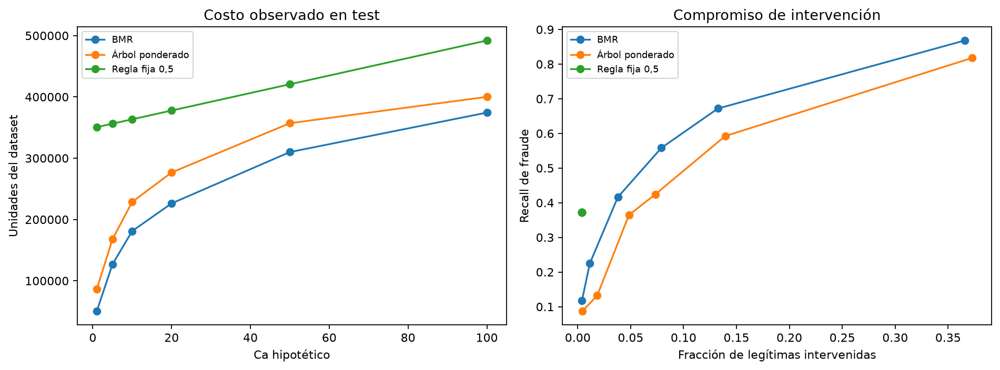

# Informe consolidado de resultados

**Proyecto Integrador II — Ingeniería de Sistemas, Universidad de Antioquia, 2026-2.**

**Equipo:** Milton Alejandro Cuervo Ramírez, Oswald David Gutiérrez Cortina y Diego Alejandro Rendón Suaza.

**Título:** Optimización basada en costos del umbral de decisión para el bloqueo de transacciones sospechosas mediante modelos de aprendizaje automático.

**Corte de consolidación:** 6 de noviembre de 2026. Este documento integra la evidencia de los notebooks 01–08. No representa una ejecución adicional ni modifica el protocolo, las predicciones o las tablas originales. Complementa los informes de etapa y el [artículo IEEE para revisión](informe_final/README.md).

## 1. Resultado principal y respuesta a la pregunta del proyecto

**Encontramos que incorporar probabilidad y monto a la decisión mediante Bayes Minimum Risk (BMR) redujo el costo frente a actuar únicamente con el corte 0,5, bajo nuestra matriz y en el periodo evaluado.** BMR obtuvo el menor costo global de las tres políticas en los seis escenarios administrativos estudiados.

Con **Ca=10 hipotético**, BMR costó **181.140,258**, frente a **363.466,629** de la regla fija y **228.707,974** del árbol ponderado. La mejora fue **50,16% frente a fija** y el ahorro **59,91% frente a la mejor referencia trivial**. Son referencias diferentes.

Este beneficio se acompañó de más intervenciones sobre legítimas. BMR capturó 77,79% del monto fraudulento e intervino 7,91% de las legítimas. El resultado responde al objetivo económico del proyecto; no demuestra que esa política produzca menos alertas o que el ahorro se mantenga en una operación bancaria real.

## 2. Datos y poblaciones que sostienen los resultados

Trabajamos con 590.540 transacciones etiquetadas y 144.233 registros de identidad. La unión izquierda uno a uno conserva las transacciones y produce 434 columnas originales; 24,42% tiene correspondencia de identidad. Encontramos 20.663 fraudes, equivalentes al 3,499% del conjunto. El 1% de fraudes de mayor monto concentra 10,63% del monto fraudulento: contar fraudes y sumar exposición económica describen aspectos distintos.

La partición se define por duración temporal, con cortes al 60% y 80% y gaps posteriores de siete días. Los bloques completos son:

| Bloque | Operaciones | Fraudes | Uso |
|---|---|---|---|
| Entrenamiento | 380.815 | 13.011 | Aprender preparación, predictores y árboles; selección interna |
| Gap 1: siete días | 20.995 | 1.015 | Excluido del ajuste y evaluación |
| Validación total | 84.093 | 3.075 | 42.046 para Platt; 42.047 para diagnóstico |
| Gap 2: siete días | 20.404 | 602 | Excluido del ajuste y evaluación |
| Prueba final | 84.233 | 2.960 | Medir el protocolo ya fijado |

Los gaps excluyen 41.399 operaciones del aprendizaje y la evaluación. La validación temprana contiene 1.558 fraudes y la posterior 1.517. La prueba final tiene 81.273 legítimas y 2.960 fraudes, con prevalencia 3,51%. Estos conteos de prueba proceden de la evaluación ya terminada; no se vuelven a consultar para rediseñar la partición.

El test sin etiquetas públicas de Kaggle no es nuestra prueba supervisada: esta última se deriva cronológicamente del conjunto etiquetado. El EDA y el diseño histórico de gaps consultaron etiquetas agregadas del periodo final; por ello, declaramos una evaluación temporal fuera del ajuste de estimadores, sin presentarla como completamente ciega desde el inicio.

## 3. Representación final y selección de LightGBM

Conservamos 431 atributos originales permitidos y añadimos `has_identity`: **432 entradas, con 37 categóricas ordinales y 395 numéricas**. ID, tiempo crudo, etiqueta y split son controles, no entradas del clasificador. Aprendemos vocabularios y medianas únicamente con el pasado autorizado; categorías nuevas reciben −1. La matriz predictiva es float32 y el monto económico se conserva en float64.

Los cuatro clasificadores comparten esas columnas; logística añade escalado sin centrar y CatBoost recibe códigos numéricos, sin categorías nativas. No aplicamos remuestreo, pesos de clase, selección automática de variables ni los agregados históricos retirados. Las doce discrepancias de códigos id tratados numéricamente permanecen identificadas en el [diccionario de variables y flujo](diccionario_variables_y_flujo_modelo.md).

Comparamos dos configuraciones de cada algoritmo mediante dos ventanas expansivas internas de train: 16 ajustes desde cero. Seleccionamos por AP media, dando igual peso a cada ventana. Las otras métricas son diagnósticos y no cambian retrospectivamente el criterio.

| Configuración | AP media raw | Recall medio a 0,5 | Precision media a 0,5 | FPR media |
|---|---|---|---|---|
| LightGBM referencia | 0,58812 | 34,32% | 87,25% | 0,20% |
| LightGBM regularizada | 0,56857 | 33,63% | 87,48% | 0,19% |
| XGBoost referencia | 0,55486 | 32,28% | 87,42% | 0,19% |
| XGBoost regularizada | 0,52203 | 28,48% | 87,06% | 0,17% |
| CatBoost referencia | 0,51511 | 29,07% | 88,59% | 0,15% |
| CatBoost regularizada | 0,49123 | 26,85% | 87,40% | 0,16% |
| Logística referencia | 0,37069 | 16,44% | 82,62% | 0,14% |
| Logística regularizada | 0,37068 | 16,44% | 82,62% | 0,14% |

**LightGBM referencia fue el ganador por AP media interna: 0,58812.** No fue el mejor en todas las métricas: CatBoost referencia tuvo mayor precision media al corte 0,5. Dos ventanas no permiten afirmar significación estadística ni identificar el mejor predictor posible. Tampoco seleccionamos el clasificador de menor costo entre los cuatro algoritmos.

La configuración elegida coincidió con el LightGBM completo del 03: reutilizamos ese ajuste verificado, con 250 estimadores, tasa 0,05, 63 hojas y mínimo 50 muestras por hoja, junto con su propio Platt. El [informe 04](04_seleccion_temporal_modelos.md) conserva los parámetros y el diseño completo.

## 4. Qué ocurrió con la calibración

En el 03 ajustamos un Platt propio para cada uno de los cuatro predictores, usando sus probabilidades sobre validación temprana. El calibrador recibe una columna de logits recortados, no las 432 variables originales. El 04 selecciona sobre probabilidades raw internas, sin calibrar esos ajustes; el 05 verifica y adopta LightGBM y su propio Platt ya aprendido. No trasladamos un calibrador entre modelos.

| Población | Probabilidad | AP | Brier | Log-loss | Media de p |
|---|---|---|---|---|---|
| Validación posterior | raw | 0,50440 | 0,02435 | 0,09750 | 2,76% |
| Validación posterior | platt | 0,50440 | 0,02406 | 0,09645 | 3,03% |
| Prueba final | raw | 0,51780 | 0,02279 | 0,09471 | 3,39% |
| Prueba final | platt | 0,51780 | 0,02300 | 0,09515 | 3,73% |

En validación posterior, cuya prevalencia es 3,61%, Platt mejoró Brier y log-loss, aunque mantuvo una probabilidad media inferior a la frecuencia observada. En prueba final, cuya prevalencia es 3,51%, **Platt empeoró ligeramente ambas métricas y su media quedó por encima de la prevalencia**. Conservamos el calibrador fijado antes de test.

AP se mantuvo igual entre raw y Platt dentro de cada población, consistente con preservar el orden de riesgo en esta corrida. Comparar AP interna 0,58812 con AP final 0,51780 no mide el efecto de calibrar: cambian los periodos y las poblaciones de ajuste y evaluación. AP es `average_precision_score`, no el área trapezoidal de precision–recall. Brier y log-loss tampoco aíslan exclusivamente calibración.

El resultado probabilístico no contradice el económico: **la calidad probabilística global y el costo realizado son mediciones diferentes**. No estimamos causalmente cuánto ahorro produjo Platt ni calculamos BMR raw en test como una variante para seleccionarla después.

## 5. Matriz y políticas que comparamos

| Estado observado | Aprobar | Intervenir |
|---|---|---|
| Fraude | A: monto original | Ca |
| Legítima | 0 | Ca |

Intervenir significa bloquear y revisar; suponemos que evita toda la pérdida fraudulenta. Ca se cobra en ambas clases. Todos los valores son hipotéticos en unidades de `TransactionAmt`, sin moneda verificada.

- **Fija:** interviene si p calibrada ≥ 0,5. El corte no se optimiza.
- **BMR:** interviene si p calibrada × A > Ca; aprueba en empate. Para A>0, la frontera económica es p*=Ca/A. Si A≤Ca, intervenir no reduce estrictamente el riesgo esperado.
- **Árbol ponderado:** aprende acciones por cada Ca con objetivo `1[yA>Ca]` y pesos `abs(yA−Ca)`, normalizados por su media. Recibe atributos, no probabilidades LightGBM. Su ajuste por impureza es una aproximación, no un mínimo global garantizado.

Evaluamos las mismas operaciones con la misma matriz:

```text
Costo total = Ca × intervenciones + monto de fraudes aprobados
Costo de referencia trivial = min(monto de todo fraude, N × Ca)
Ahorro frente a trivial = 1 − costo total / costo de referencia trivial
Mejora frente a fija = 1 − costo total / costo de la política fija
```

Las fracciones pueden ser negativas. Ca=1, 5, 10, 20, 50 y 100 se fijaron como sensibilidad hipotética; Ca=10 es ilustrativo, no un costo real estimado ni un valor elegido por el resultado final.

## 6. Comparación económica final en los seis escenarios

| Ca hipotético | Costo fija | Costo BMR | Costo árbol | Mejora BMR vs fija | Ahorro BMR vs trivial |
|---|---|---|---|---|---|
| 1 | 350.614,629 | 50.285,759 | 86.169,783 | 85,66% | 40,30% |
| 5 | 356.326,629 | 126.957,366 | 167.704,701 | 64,37% | 69,86% |
| 10 | 363.466,629 | 181.140,258 | 228.707,974 | 50,16% | 59,91% |
| 20 | 377.746,629 | 226.249,601 | 276.727,440 | 40,11% | 49,92% |
| 50 | 420.586,629 | 309.995,569 | 357.072,308 | 26,29% | 31,39% |
| 100 | 491.986,629 | 374.372,193 | 400.085,919 | 23,91% | 17,14% |

BMR tuvo el menor costo en los seis escenarios completos. La mejor referencia trivial cambia: con Ca=1 y Ca=5 es intervenir todo; desde Ca=10 es aprobar todo, dentro de esta cuadrícula. Con Ca=1, el árbol cuesta más que intervenir todo; con Ca=100, fija cuesta más que aprobar todo. Mejorar frente a fija no basta para superar una referencia trivial.

No promediamos ahorros entre escenarios ni interpretamos el menor costo absoluto entre distintos Ca como una elección operativa: cambiar Ca modifica el problema económico. Tampoco demostramos qué ocurre entre los seis valores evaluados.



## 7. Lectura detallada del escenario Ca=10

### 7.1. Acciones y matriz de confusión

| Política | Intervenciones | TP | FP | FN | TN |
|---|---|---|---|---|---|
| Fija 0,5 | 1.428 | 1.103 | 325 | 1.857 | 80.948 |
| BMR | 8.081 | 1.653 | 6.428 | 1.307 | 74.845 |
| Árbol ponderado | 7.212 | 1.256 | 5.956 | 1.704 | 75.317 |

TP y FN son fraudes intervenidos y aprobados; FP y TN, legítimas intervenidas y aprobadas. Al evaluar BMR o el árbol, son conteos de acciones económicas, que pueden diferir de las etiquetas del clasificador al corte 0,5.

| Política | Recall de fraude | Precision | Legítimas intervenidas (FPR) | Recall por monto |
|---|---|---|---|---|
| Fija 0,5 | 37,26% | 77,24% | 0,40% | 22,71% |
| BMR | 55,84% | 20,46% | 7,91% | 77,79% |
| Árbol ponderado | 42,43% | 17,42% | 7,33% | 65,34% |

Recall mide la proporción de fraudes intervenidos; precision, la proporción de fraudes entre intervenciones. FPR utiliza como denominador todas las legítimas, no todas las alertas. Recall por monto mide la fracción del monto fraudulento intervenida, sin descontar gastos administrativos.

En términos netos, BMR registró 6.653 intervenciones más que fija: 550 fraudes y 6.103 legítimas más intervenidas. Estas diferencias de conteos no suponen que todas las acciones de una política sean un subconjunto de las de la otra. Bajo nuestra matriz, la reducción de monto fraudulento aprobado compensó el gasto administrativo adicional. Esa es la explicación económica del resultado, sin atribuir causalidad al calibrador.

### 7.2. Componentes y denominadores del ahorro

| Política | Intervención: Ca × alertas | Monto de fraudes aprobados | Costo total |
|---|---|---|---|
| Fija 0,5 | 14.280,000 | 349.186,629 | 363.466,629 |
| BMR | 80.810,000 | 100.330,258 | 181.140,258 |
| Árbol ponderado | 72.120,000 | 156.587,974 | 228.707,974 |

Para BMR, 80.810,000 + 100.330,258 = **181.140,258**. La reducción absoluta frente a fija es **182.326,371**. Frente a aprobar todo, que cuesta 451.813,181, la reducción es 270.672,923.

Los porcentajes 50,16% y 59,91% no son dos estimaciones del mismo ahorro: contestan comparaciones distintas. Las cifras monetarias se presentan con tres decimales para conciliar los componentes; las tasas se redondean a dos.

## 8. Qué se mantuvo y qué cambió respecto a validación

| Medida BMR con Ca=10 | Validación posterior | Prueba final |
|---|---|---|
| Operaciones | 42.047 | 84.233 |
| Costo por operación | 2,0018 | 2,1505 |
| Recall | 55,57% | 55,84% |
| FPR | 5,78% | 7,91% |
| Recall por monto | 79,45% | 77,79% |
| Mejora frente a fija | 57,51% | 50,16% |

El recall se mantuvo cercano, mientras aumentaron la intervención de legítimas y el costo por operación. La mejora relativa frente a fija disminuyó. Test contiene aproximadamente el doble de operaciones; por eso comparamos tasas y costo por operación, no costos absolutos como si las muestras fueran iguales.

En validación, BMR fue el de menor costo en los seis escenarios globales y en 17 de 18 combinaciones periodo/Ca. La excepción fue el tercer periodo con Ca=100: árbol 60.920,554 frente a BMR 62.314,953. Además, Platt redujo el costo BMR frente a raw en cuatro de seis escenarios, no en todos. Estas excepciones permanecen como hallazgos del desarrollo; no se eliminan porque test haya sido favorable a BMR.

## 9. Estabilidad dentro del periodo final

Dividimos test en tres subperiodos de igual duración, definidos por TransactionDT. No entrenamos dentro de ellos y conservamos los instantes simultáneos juntos. Sus volúmenes son diferentes:

| Periodo | Operaciones | Prevalencia | AP | Costo BMR, Ca=10 | Recall BMR | FPR BMR |
|---|---|---|---|---|---|---|
| 1 | 29.490 | 3,09% | 0,53865 | 58.509,658 | 59,28% | 6,94% |
| 2 | 29.281 | 3,38% | 0,42630 | 66.344,236 | 50,51% | 9,60% |
| 3 | 25.462 | 4,16% | 0,59202 | 56.286,364 | 57,88% | 7,09% |

BMR tuvo menor costo en las 18 combinaciones periodo/Ca. La AP cayó en el segundo periodo y se recuperó en el tercero; no hubo una degradación monótona. Platt empeoró Brier/log-loss en los dos primeros periodos y los mejoró ligeramente en el tercero. Estas diferencias describen la muestra, sin demostrar deriva de concepto, causalidad o superioridad estadística.

## 10. Calidad probabilística y exposición por monto

La exposición esperada ΣpA usa probabilidades Platt y montos originales antes de aplicar la política; se contrasta con el monto fraudulento observado, no con el costo total de BMR.

| Monto | Operaciones | Fraudes | Frecuencia observada | Media Platt | Monto fraudulento observado | Exposición esperada ΣpA |
|---|---|---|---|---|---|---|
| [0,50) | 27.001 | 1.159 | 4,29% | 4,31% | 30.958,69 | 30.039,19 |
| [50,100) | 22.771 | 640 | 2,81% | 2,80% | 43.989,81 | 44.445,78 |
| [100,250) | 25.412 | 690 | 2,72% | 3,57% | 98.542,89 | 129.298,61 |
| [250,500) | 5.469 | 258 | 4,72% | 4,80% | 87.859,89 | 88.006,11 |
| [500,1000) | 2.332 | 172 | 7,38% | 5,84% | 128.656,95 | 93.714,35 |
| [1000,∞) | 1.248 | 41 | 3,29% | 2,87% | 61.804,96 | 56.971,87 |

La banda [500,1000) conserva subestimación: 7,38% observado frente a media Platt 5,84%; su exposición esperada fue 93.714,35 frente a 128.656,95 observados. En [100,250) ocurrió sobreestimación. Globalmente, ΣpA suma **442.475,91**, frente a **451.813,18** observados: 2,07% por debajo.

La cercanía global combina diferencias de signos distintos y no garantiza calibración por grupo. Tampoco contradice que la media global de probabilidades esté por encima de la prevalencia: ponderar por monto cambia qué operaciones contribuyen más. Los tamaños y fraudes por banda deben acompañar la interpretación; no estimamos significación estadística de esas diferencias.

## 11. Respuesta a los objetivos

| Objetivo | Evidencia y resultado | Alcance |
|---|---|---|
| Formalizar costos y condición de intervención | Matriz dependiente del monto; BMR interviene si pA>Ca | Depende de intervención ideal y Ca hipotético |
| Establecer referencia predictiva y probabilística temporal | Cuatro algoritmos, ocho configuraciones y Platt propio; LightGBM seleccionado por AP | Orden cronológico conservado, con consulta histórica agregada de test declarada; Platt no mejoró todas las métricas finales |
| Comparar tres políticas económicas | BMR obtuvo menor costo global en seis escenarios finales | Resultado descriptivo de esta población, no superioridad universal |
| Analizar sensibilidad administrativa | Seis Ca y tres subperiodos; el ganador global no cambió en la cuadrícula | No identificamos rangos continuos ni estimamos Ca operativo |

## 12. Conclusión y límites del resultado

**La decisión sensible al costo fue útil en nuestro experimento.** La evidencia central es una reducción de 50,16% frente a fija con Ca=10 y un menor costo global BMR en los seis escenarios evaluados. Conseguimos explicar ese beneficio mediante monto fraudulento aprobado, gasto de intervención y cambios de acciones; no lo reducimos a una mejora de clasificación.

El compromiso también quedó cuantificado: más legítimas intervenidas y menor precision entre alertas. El deterioro probabilístico de Platt en test es un hallazgo distinto que no invalida la comparación económica, pero impide presentarlo como una mejora garantizada o atribuirle todo el ahorro.

Para defender el resultado conservamos estos límites:

1. Ca es hipotético y no hay moneda verificada ni pérdidas bancarias netas medidas.
2. Suponemos intervención eficaz; no modelamos capacidad limitada, recuperación, revisión imperfecta o perjuicio comercial adicional.
3. Ordinal impone orden artificial; doce id permanecen numéricos y CatBoost no usa categorías nativas.
4. Seleccionamos el predictor por AP, no por costo entre los cuatro clasificadores.
5. La exposición histórica de etiquetas agregadas de test y el uso de validación como desarrollo limitan la independencia; no afirmamos una prueba completamente ciega.
6. No estimamos intervalos de confianza ni pruebas de superioridad estadística. Otra variante requiere un experimento explícito y un periodo nuevo para una evaluación independiente.

La construcción técnica 01–08 está concluida. Restan la revisión del artículo por el equipo, las observaciones y el aval docente y la sustentación. Este informe consolida evidencia; no sustituye el aval requerido por el curso.

## 13. Evidencia y consulta reproducible

Las tablas de este documento se construyeron desde CSV agregados ya existentes, sin cargar modelos, generar nuevas probabilidades o reajustar estimadores. Las tasas medias del ranking dan igual peso a las dos ventanas; no equivalen a una matriz de confusión combinada. Los resultados de validación y test se mantienen separados.

- [Inventario y recorrido de variables](diccionario_variables_y_flujo_modelo.md).
- [Selección: tabla de ocho configuraciones](../results/tables/seleccion_ordinal_resumen.csv) e [informe 04](04_seleccion_temporal_modelos.md).
- [Métricas LightGBM de validación](../results/tables/lightgbm_metricas_validation.csv) y [costos de validación](../results/tables/lightgbm_costos_validation.csv).
- [Métricas probabilísticas finales](../results/tables/test_metricas_probabilidades.csv) y [costos globales finales](../results/tables/test_costos.csv).
- [Periodos finales](../results/tables/test_periodos.csv), [métricas por periodo](../results/tables/test_metricas_periodo.csv) y [costos por periodo](../results/tables/test_costos_periodo.csv).
- [Calibración por monto](../results/tables/test_calibracion_montos.csv).
- [Informe 08: evaluación final y procedencia](08_evaluacion_temporal_final.md).
- [Auditoría consolidada](../results/tables/auditoria_proyecto.json) y [registro de evaluación](../results/tables/evaluacion_test_config.json).

La auditoría registrada tiene estado `passed` y alcance `local_full`. Las 49 pruebas aprobadas corresponden a la verificación de implementación documentada; no se presentan como evidencia estadística adicional. En un entorno instalado, el comando de consulta es:

```powershell
.\.venv\Scripts\python.exe scripts/audit_project.py
```

Ese comando verifica estructura, integridad y aritmética sin reentrenar ni repetir predicciones. Con las dependencias locales conservadas, `--local` amplía la comprobación a CSV originales, manifiesto y evidencias locales. No se deben regenerar etapas previas sobre las rutas congeladas para consultar el proyecto cerrado.
